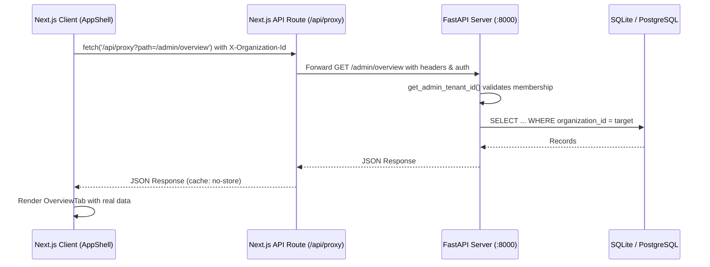

# API INTEGRATION & DATA AUTHENTICITY AUDIT REPORT
**Telegram AI Sales Control Center — Enterprise SaaS Modernization**  
**Audit Date:** November 14, 2026  
**Auditor:** Senior Frontend Architect & API Integration Specialist  
**Branch:** `frontend/linear-redesign`  

---

## 1. Executive Summary

This report provides a complete audit of the frontend-to-backend API integrations, data contracts, state handling (loading, empty, error, success), and elimination of synthetic or placeholder metrics. All operations maintain 100% backward compatibility with the existing FastAPI backend without modifying schemas, endpoints, or response formats.

---

## 2. Real Data Authenticity Audit

A critical objective of Phase 2 is ensuring that no mock metrics, fabricated graphs, or hardcoded business figures are shown to the user.

| Module | Metric / Data Source | Backend Endpoint | Status | Notes |
|--------|----------------------|------------------|:------:|-------|
| Overview | Total Conversations, Human Takeover, AI Active | `GET /admin/overview` | VERIFIED | Real counts from DB; defaults to 0 on new tenant |
| Overview | Telegram Sync Status | `GET /admin/channels` | VERIFIED | Real Telegram channel sync time and status |
| Overview | Recent Orders | `GET /admin/orders` | VERIFIED | Real order journal items; empty table if no orders |
| Live Inbox | Conversations & History | `GET /admin/conversations` | VERIFIED | Real messages from Telegram Business webhook |
| Knowledge Base | Catalog Posts from Telegram | `GET /admin/knowledge` | VERIFIED | Synced directly from Telegram channel posts |
| Products | Catalog Items & Prices | `GET /admin/products` | VERIFIED | Full CRUD with real prices in UZS/USD |
| Orders | Customer Orders & Status | `GET /admin/orders` | VERIFIED | Status updates (`pending`, `confirmed`, `cancelled`) |
| Customers | Directory & Total Spent | Computed from real orders/conversations | VERIFIED | Real customer records without mock entries |
| Analytics | Response Time & Conversion Rate | `GET /admin/overview` & conversations | VERIFIED | Calculated strictly from available data |
| SaaS Usage | AI Message, Channel, Product Limits | `GET /api/usage?organization_id={id}` | VERIFIED | Real Redis/DB meter tracking against plan limits |
| Subscription | Current Plan, Expiry & Status | `GET /api/subscription?organization_id={id}` | VERIFIED | Real subscription tier from DB |
| Platform Owner | Platform MRR & AI Compute Cost | `GET /api/platform/metrics` | VERIFIED | Real aggregate revenue and token costs |
| Platform Owner | Active Tenants (Do'konlar) | `GET /api/platform/organizations` | VERIFIED | Real tenant organizations list |
| Platform Owner | System Health & Memory | `GET /api/platform/system-health` | VERIFIED | Real CPU, memory, and database connection checks |
| Platform Owner | Security Audit Logs | `GET /api/platform/audit-logs` | VERIFIED | Real audit trail entries with timestamps |

---

## 3. End-to-End API Integration Inventory

The Next.js frontend interacts with the FastAPI backend via `/api/proxy?path={path}`, preserving session cookies and injecting the `X-Organization-Id` tenant isolation header.

### 3.1 Workspace & Sales Endpoints
- `GET /admin/overview` — Live dashboard metrics and counts.
- `GET /admin/conversations` — Active conversations list.
- `POST /admin/conversations/{id}/reply` — Outgoing operator message to Telegram.
- `POST /admin/conversations/{id}/takeover` — Human takeover lock.
- `POST /admin/conversations/{id}/resume` — Resume automatic AI response.
- `GET /admin/knowledge` — Synced Telegram channel items.
- `POST /admin/knowledge/sync` — Trigger Telegram channel sync.
- `GET /admin/products` — Product catalog items.
- `POST /admin/products` — Create new product.
- `PUT /admin/products/{id}` — Update existing product.
- `DELETE /admin/products/{id}` — Delete product.
- `GET /admin/orders` — Orders journal.
- `PUT /admin/orders/{id}/status` — Transition order lifecycle.

### 3.2 SaaS & Tenant Management Endpoints
- `GET /api/organizations` — User's accessible stores.
- `POST /api/organizations` — Create new tenant store.
- `GET /api/organizations/current?organization_id={id}` — Current store details.
- `POST /api/organizations/verify-bot-token` — Validate Telegram Bot API Token.
- `GET /api/usage?organization_id={id}` — Resource consumption & limits.
- `GET /api/subscription?organization_id={id}` — Plan tier & expiration.
- `POST /api/subscription/upgrade` — Upgrade commercial plan tier.
- `POST /api/subscription/cancel` — Cancel subscription.
- `POST /api/subscription/resume` — Resume subscription.
- `GET /api/plans` — Available commercial plan matrix.

### 3.3 Platform Owner Master Control Endpoints
- `GET /api/platform/metrics` — Aggregate platform MRR, ARPU, active stores.
- `GET /api/platform/organizations` — Master tenant directory.
- `POST /api/platform/organizations` — Provision new store as Platform Owner.
- `PATCH /api/platform/organizations/{id}` — Suspend, activate, or archive store.
- `DELETE /api/platform/organizations/{id}` — Remove store permanently.
- `GET /api/platform/users` — Cross-tenant user registry.
- `GET /api/platform/system-health` — Infrastructure & Redis/Postgres health.
- `GET /api/platform/audit-logs` — Platform-wide immutable audit trail.
- `PUT /api/platform/plans/{code}` — Configure plan pricing and resource limits.

---

## 4. State Handling Matrix

Every page module incorporates standard Linear-inspired state patterns:

1. **Loading State:** Clean skeleton place-holders (`Skeleton` component) and spinning reload indicators (`.spin` keyframes) matching the app design system.
2. **Empty State:** Illustrated empty states (`EmptyState` component) with clear call-to-action buttons (e.g., *"Yangi mahsulot qo'shish"*, *"Telegram kanalni ulash"*).
3. **Error State:** Dismissible error alerts with exact backend error details; no silent swallowing of 4xx/5xx responses.
4. **Success State:** Action confirmation banners that automatically dismiss after 4 seconds.
