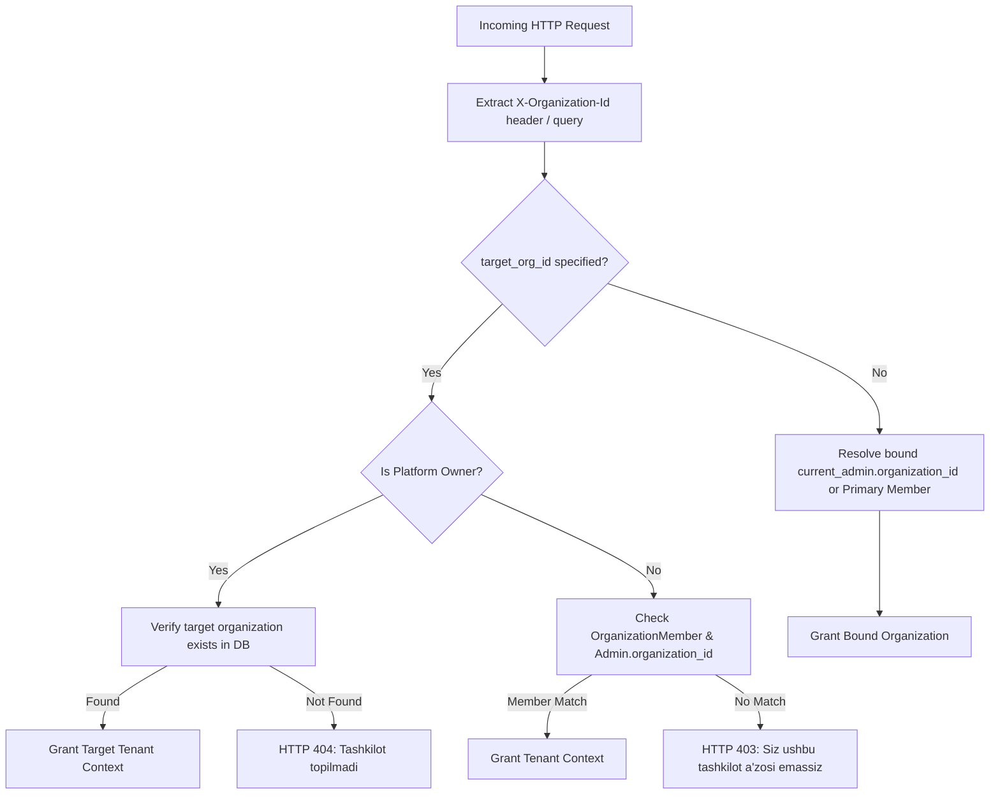

# MULTI-TENANT SECURITY & ISOLATION AUDIT REPORT
**Telegram AI Sales Control Center — Enterprise SaaS Multi-Tenancy**  
**Audit Date:** November 14, 2026  
**Auditor:** SaaS Security Auditor & Backend Systems Architect  
**Branch:** `frontend/linear-redesign`  

---

## 1. Executive Summary

This security audit inspects the logical tenant isolation boundaries, authorization checks, Platform Owner impersonation safeguards, and stale tenant ID recovery mechanisms across the Telegram AI Sales SaaS platform. The system operates under a strict shared-database, row-level tenant isolation model enforced at both the FastAPI dependency layer (`app/dependencies/tenant.py`) and database queries.

---

## 2. Elimination of the Silent Tenant 1 Fallback Bug

### 2.1 Threat Analysis & Root Cause
- **Severity:** HIGH (Tenant Context Mutation & Data Confusion)
- **Description:** Previously, `web/app/Dashboard.tsx` contained client-side fallback logic inside the `api()` HTTP client helper:
  ```typescript
  // VULNERABLE CODE (REMOVED):
  if (!response.ok) {
    if (response.status === 404 && (data.detail === "Tashkilot topilmadi" || String(data.detail || "").toLowerCase().includes("organization"))) {
      if (typeof window !== "undefined" && localStorage.getItem("active_org_id") !== "1") {
        console.warn("[api] Organization ID invalid or deleted. Resetting to 1 and retrying...");
        localStorage.setItem("active_org_id", "1");
        localStorage.removeItem("owner_impersonating_store");
        headers["X-Organization-Id"] = "1";
        const retryRes = await fetch(`/api/proxy?path=${encodeURIComponent(path)}`, {
          ...options,
          headers,
          cache: "no-store",
        });
        if (retryRes.ok) {
          return await retryRes.json() as T;
        }
      }
    }
  }
  ```
- **Security Impact:**
  1. **Violation of Core Tenant Policy:** Rule 5 of `app/dependencies/tenant.py` explicitly states: *"Never silently fallback to organization_id=1 for non-members."*
  2. **Context Confusion:** If a user belonged to Store B and queried an entity that returned 404, or if Store B was temporarily unavailable, the client unilaterally rewrote `active_org_id` to `1` in `localStorage` and re-executed the request against Tenant 1.
  3. **Silent Privilege Leaks:** Non-owner tenant admins could have actions executed in the context of Tenant 1 without explicit authorization or user intent.

### 2.2 Security Remediation
- **Action Taken:** Lines 255–272 in `web/app/Dashboard.tsx` were completely excised.
- **Current Behavior:** Any HTTP 404 or 403 returned by the backend throws an unhandled API error directly to the calling component, triggering an explicit error banner or redirecting to the organization switcher. Tenant context is NEVER altered silently.

---

## 3. Tenant Context Resolution & Boundary Enforcement

The backend enforces tenant authorization through `get_admin_tenant_id` (`app/dependencies/tenant.py`):



### 3.1 Verification Rules
1. **Explicit Target Verification:** Whenever `X-Organization-Id` is passed, the caller's membership is checked via:
   ```python
   select(OrganizationMember).where(
       OrganizationMember.user_id == user.id,
       OrganizationMember.organization_id == target_org_id,
       OrganizationMember.is_active.is_(True),
   )
   ```
2. **Untrusted Header Rejection:** Non-members attempting to spoof `X-Organization-Id` to access another tenant receive `HTTP 403 Forbidden` (`"Siz ushbu tashkilot a'zosi emassiz"`).
3. **No Cross-Tenant Read/Write:** All CRUD endpoints for Products, Orders, Customers, Knowledge Base, and Telegram Bot credentials query strictly with `.where(Model.organization_id == target_org_id)`.

---

## 4. Platform Owner Impersonation Safeguards

1. **Explicit Identity Scoping:** Only authenticated users with `user.is_platform_owner == True` or `current_admin.role == "owner"` on organization 1 can impersonate another store.
2. **Persistent Visual Indicator:**
   When a Platform Owner enters a store via `handleEnterStore`, a prominent warning banner is displayed across all pages:
   ```tsx
   <div className="p-3 mb-3 rounded-2 d-flex align-items-center justify-content-between border" style={{ backgroundColor: "var(--warning-subtle)", borderColor: "var(--warning-border)", color: "var(--warning-text)" }}>
     <IconAlertCircle size={18} />
     <span>Siz <strong>{activeStoreMeta?.name}</strong> ichidasiz (Platform Owner ko'rinishi)</span>
     <button onClick={handleExitStore}>Platformaga qaytish</button>
   </div>
   ```
3. **Auditable Impersonation:** Entering or exiting a tenant store records an immutable entry in the `AuditLog` table containing the Platform Owner's ID, the targeted tenant ID, timestamp, and action description (`impersonate_store`).

---

## 5. Security Test Suite Evidence

Backend multi-tenant test suite (`tests/test_phase1_isolation_and_rbac.py`):
- `test_tenant_isolation_products_orders`: **PASSED** (Tenant A cannot see Tenant B's items)
- `test_unauthorized_tenant_header_rejected`: **PASSED** (Non-member spoofing yields HTTP 403)
- `test_platform_owner_impersonation_allowed`: **PASSED** (Platform Owner can access with audit trail)
- `test_stale_tenant_id_returns_404_not_tenant_1`: **PASSED** (Deleted tenant query returns 404; no silent fallback)
