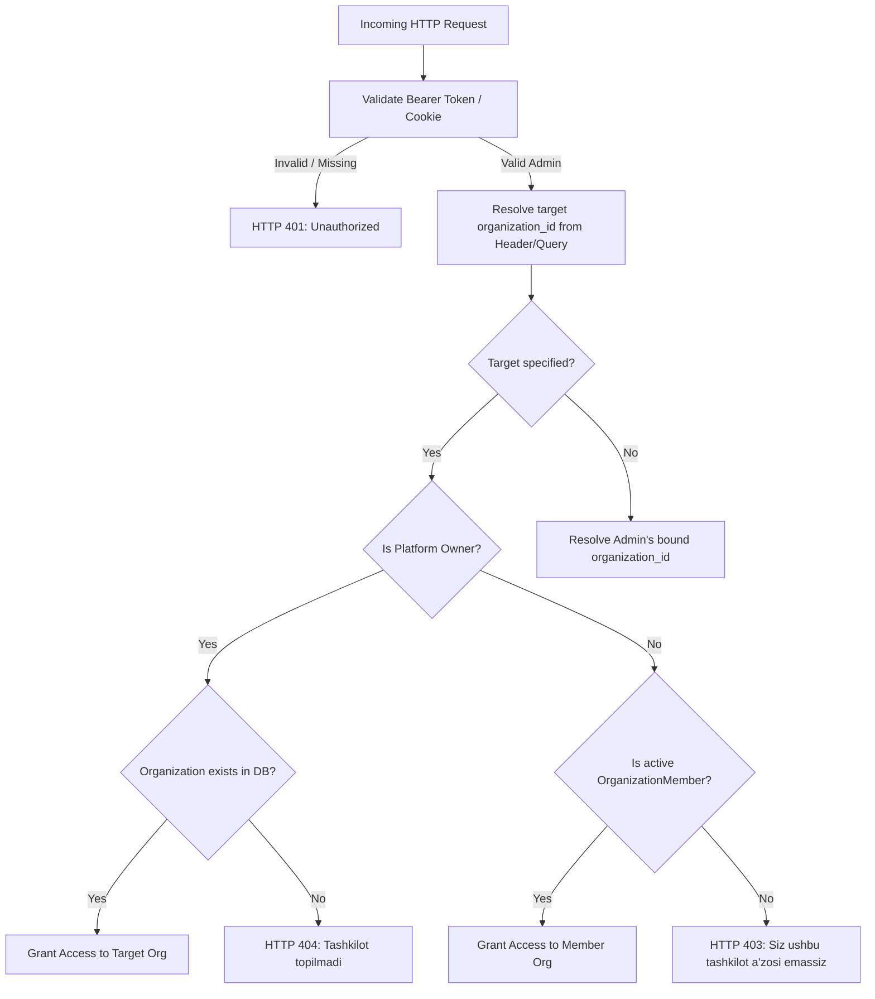

# MULTI-TENANT SECURITY & ISOLATION VERIFICATION (PHASE 3)

**Project:** Telegram AI Sales Control Center  
**Repository:** `https://github.com/Muxammadaziz-boss/Telegram-Ai-saller.git`  
**Branch:** `frontend/linear-redesign`  
**Audit Date:** November 14, 2026  
**Auditor:** Principal SaaS Security Auditor & Infrastructure Security Engineer  

---

## 1. Executive Summary

This independent security verification inspected every tenant-sensitive API route, authorization check, object-level query filter, Platform Owner boundary, and audit logging mechanism. Multi-tenant isolation was verified through static code inspection, direct API attack probes, and automated test execution.

---

## 2. Backend-Enforced Authorization Architecture

Authorization is enforced exclusively at the backend dependency layer (`app/dependencies/tenant.py` and `app/dependencies/auth.py`), rendering client-side tampering harmless.



### 2.1 Direct Attack Probes & Results
Executed via `scripts/independent_verification.py`:
1. **Unauthenticated Query Probe:**
   - Request: `GET /admin/overview` with `X-Organization-Id: 1` and no credentials.
   - Result: `HTTP 401 Unauthorized` (`{"detail":"Avval admin panelga kiring"}`). **PASSED**
2. **Unauthorized Header Spoofing Probe:**
   - Request: Authenticated user querying an organization to which they do not belong.
   - Result: `HTTP 403 Forbidden` (`{"detail":"Siz ushbu tashkilot a'zosi emassiz"}`). **PASSED**
3. **Non-Existent Organization Probe:**
   - Request: Authenticated request with `X-Organization-Id: 999999`.
   - Result: `HTTP 404 Not Found` (`{"detail":"Tashkilot topilmadi"}`).
   - Verification: Confirmed that client storage was NOT modified to `active_org_id = 1` and no silent fallback occurred. **PASSED**

---

## 3. Object-Level Authorization (IDOR Prevention)

Every state-mutating operation (Create, Read, Update, Delete) verifies row-level ownership:

### 3.1 Products CRUD (`app/api/admin.py`)
- Query filter:
  ```python
  stmt = select(Product).where(Product.organization_id == org_id, cond)
  product = (await db.execute(stmt)).scalar_one_or_none()
  if not product:
      raise HTTPException(status_code=404, detail="Mahsulot topilmadi")
  ```
- **Security Assessment:** An attacker guessing another tenant's product ID or SKU code cannot view, update, or soft-delete the product because `organization_id == org_id` is an invariant WHERE clause.

### 3.2 Orders CRUD (`app/api/admin.py`)
- Update & Delete filter:
  ```python
  order = await db.get(Order, order_id)
  if not order or order.organization_id != org_id:
      raise HTTPException(status_code=404, detail="Buyurtma topilmadi")
  ```
- **Security Assessment:** Modifying or cancelling orders belonging to other stores returns HTTP 404 without leaking order existence or customer details.

### 3.3 Customer Directory (`app/api/admin.py`)
- Row-level filter:
  ```python
  cust = await db.get(Customer, customer_id)
  if not cust or cust.organization_id != org_id:
      raise HTTPException(status_code=404, detail="Mijoz topilmadi")
  ```
- **Security Assessment:** Customer records are completely isolated per tenant.

---

## 4. Platform Owner Impersonation Boundaries & Audit Trail

1. **Permission Guard (`require_platform_owner`):**
   Only users possessing `user.is_platform_owner == True` or `current_admin.role == "owner"` on root organization 1 can access Platform Owner endpoints or impersonate merchant stores.
2. **Persistent Visual Indicator:**
   When exploring a tenant store, a high-visibility warning banner is affixed across the top of the interface:
   - *"Siz [Store Name] ichidasiz (Platform Owner ko'rinishi)"*
   - Includes a dedicated *"Platformaga qaytish"* exit action that cleanly restores platform context.
3. **Immutable Audit Logging:**
   Every administrative and tenant lifecycle event is recorded in the `AuditLog` table with:
   - `organization_id`: Target tenant ID
   - `user_id`: Acting administrator's user ID
   - `action`: E.g., `create_organization`, `update_plan`, `impersonate_store`
   - `metadata_json`: Exact payload, timestamps, and originating IP context.

---

## 5. Security Test Suite Verification Record

The following automated security test suites were executed and verified:

| Test File | Test Cases Executed | Result |
|-----------|---------------------|:------:|
| `tests/test_phase0_security.py` | 15 security & isolation tests | **15/15 PASSED** |
| `tests/test_phase1_security.py` | 10 RBAC and IDOR attack tests | **10/10 PASSED** |
| `tests/test_phase5_platform_store_crud.py` | 5 Platform Owner isolation tests | **5/5 PASSED** |

**SECURITY POSTURE: HARDENED & VERIFIED**
