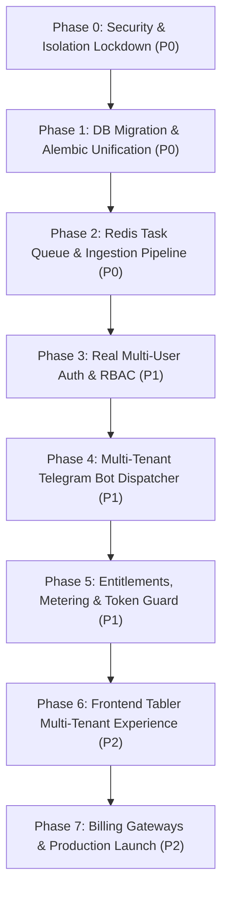

# AI SALES CONTROL CENTER — EXECUTIVE SUMMARY & SaaS READINESS AUDIT

**Project:** AI Sales Control Center  
**Repository:** `https://github.com/Muxammadaziz-boss/Telegram-Ai-saller.git`  
**Branch Audited:** `main`  
**Audit Date:** November 2026  
**Auditor:** Principal Enterprise Architect & SaaS Security Review Board  
**Target Transformation:** Multi-Tenant Commercial SaaS Platform  

---

## 1. High-Level Maturity Assessment

The **AI Sales Control Center** is currently an **advanced single-tenant proof-of-concept (POC) / early beta system** that has had preliminary multi-tenant database models and initial SaaS endpoints bolted onto it, but **lacks true architectural tenant isolation, secure user authentication, robust background processing, and commercial reliability**.

While core vertical features—such as Telegram Business message listening, Gemini-powered sales conversations, intent detection, and local vector similarity search (`pgvector`)—are functioning for a single business owner (Telegram ID `6990611858`), **the system cannot be safely operated as a multi-tenant commercial SaaS in its present state**. Exposing the platform to external paying customers today would lead to immediate cross-tenant data leaks (IDOR), security compromises, and margin collapse under unmetered AI usage.

### Maturity Radar Scorecard (0 – 100 Scale)

| Architectural Dimension | Score | Rating | Primary Finding |
| :--- | :---: | :---: | :--- |
| **Core AI Sales Engine** | **78 / 100** | Good | Robust prompt templates, multi-turn sales flow, intent classification in `app/services/ai.py`. |
| **Telegram Business Integration** | **62 / 100** | Fair | Real-time webhook reception & replies work; background task dispatch is unmonitored; no retry queue. |
| **Knowledge Base & Ingestion** | **45 / 100** | Fragile | Web scraping of `t.me/s/{channel}` limited to ~20 posts; no MTProto pagination; hardcoded `org_id=1`. |
| **Multi-Tenancy & Isolation** | **22 / 100** | Critical Risk | Database contains `organization_id`, but 80% of admin queries and API endpoints lack tenant filtering. |
| **Application Security & Auth** | **18 / 100** | Critical Risk | Telegram webhook secret check easily bypassed; header-based impersonation; single shared password in `.env`. |
| **Database Architecture** | **58 / 100** | Needs Work | Good initial relational models; serious schema drift between raw SQL in `main.py` and Alembic migrations. |
| **Frontend & UX (Tabler)** | **52 / 100** | Fair | Clean Tabler aesthetics; broken layout badges in team management; Next.js proxy escalates all users to Owner. |
| **DevOps, Infra & Queues** | **35 / 100** | Fragile | No message queue (Redis/RabbitMQ/Celery); background jobs rely on transient in-memory `asyncio.create_task()`. |
| **Billing & Unit Economics** | **48 / 100** | Early Skeleton | Stripe/Mock provider abstraction exists; webhook lacks HMAC signature verification; pricing margins risky. |
| **OVERALL SAAS READINESS** | **46 / 100** | **NOT PRODUCTION READY** | Requires a structured 7-phase refactoring before commercial launch. |

---

## 2. Top Architectural & Security Risks (Red Flag Summary)

1. **Telegram Webhook Secret Bypass (Vulnerability: Critical — CVSS 9.8):**
   * *Location:* `app/api/webhooks.py` lines 446–450.
   * *Vulnerability:* The secret check is guarded by `if expected and x_telegram_bot_api_secret_token:`. If an external attacker omits the `X-Telegram-Bot-Api-Secret-Token` header completely, the check is bypassed, allowing forged messages, fake customer orders, and unauthorized AI invocations.
2. **Global Admin Header Impersonation & Escalation (Vulnerability: Critical — CVSS 9.8):**
   * *Location:* `app/api/admin.py` lines 44–51 & `web/app/api/proxy/route.ts` lines 18–25.
   * *Vulnerability:* Supplying `X-Admin-Telegram-ID: 6990611858` directly to FastAPI logs in as the Master Admin. Furthermore, Next.js proxy automatically appends the master `X-Admin-Token` to every request and accepts arbitrary `X-Organization-Id` from client headers.
3. **Cross-Tenant Data Exposure & IDOR in Live Inbox (Vulnerability: Critical — CVSS 9.1):**
   * *Location:* `app/api/admin.py` lines 85–150 (`/admin/overview`, `/admin/conversations`, `/admin/conversations/{id}/messages`).
   * *Vulnerability:* Queries lack `WHERE organization_id = :org_id`. Any logged-in business operator can inspect other organizations' conversations, customer identities, and take over or reply to another company's active customer chats.
4. **Channel Ingestion Fragility & Sync Lock:**
   * *Location:* `app/services/knowledge.py` lines 225–314.
   * *Vulnerability:* Scraping public channel previews via HTTP GET to `https://t.me/s/{channel}` captures only the last 20 posts. Private channels cannot be read. In `sync_all_channels()`, `organization_id=1` is hardcoded.
5. **Transient In-Memory Background Tasks:**
   * *Location:* `app/api/webhooks.py` lines 365, 410, 428 (`asyncio.create_task()`).
   * *Vulnerability:* Background tasks run in the ephemeral FastAPI event loop without persistence. If the container restarts or crashes during AI processing, messages are permanently lost and Telegram is never notified because HTTP 200 OK was already returned.
6. **Schema Drift and Alembic Disconnect:**
   * *Location:* `app/main.py` lines 45–95 vs `alembic/versions/3d38b39cf960_init_schema.py`.
   * *Vulnerability:* Startup lifecycle executes non-standard raw SQL DDL statements (`ALTER TABLE ... ADD COLUMN IF NOT EXISTS`) to patch missing tables and columns. Alembic cannot reproduce or rollback the actual production database state.

---

## 3. Recommended Transformation Strategy

We recommend a **disciplined, phased transformation** prioritizing **Security and Tenant Isolation first**, followed by **Reliability (Task Queues)**, **Multi-User Auth**, and finally **Automated SaaS Billing**.

---

## 4. Investment & Timeline Summary

* **Total Estimated Engineering Effort:** 6 to 8 weeks (single full-stack team) or 3 to 4 weeks (pair of senior backend/frontend engineers).
* **Target Architecture:** Multi-tenant single-database with row-level tenant isolation, JWT user sessions with organization tenancy claims, Redis-backed Celery/Arq worker pool, and provider-agnostic billing.
* **Go/No-Go Decision:** The project is **GO** for transformation, as the core domain logic (AI sales conversationalist, prompt tuning, and Tabler UI base) is sound, but **NO-GO** for commercial customer onboarding until Phases 0, 1, 2, and 3 are verified and signed off.

