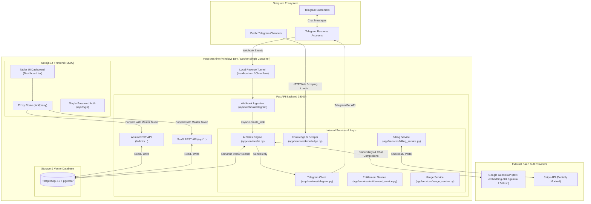
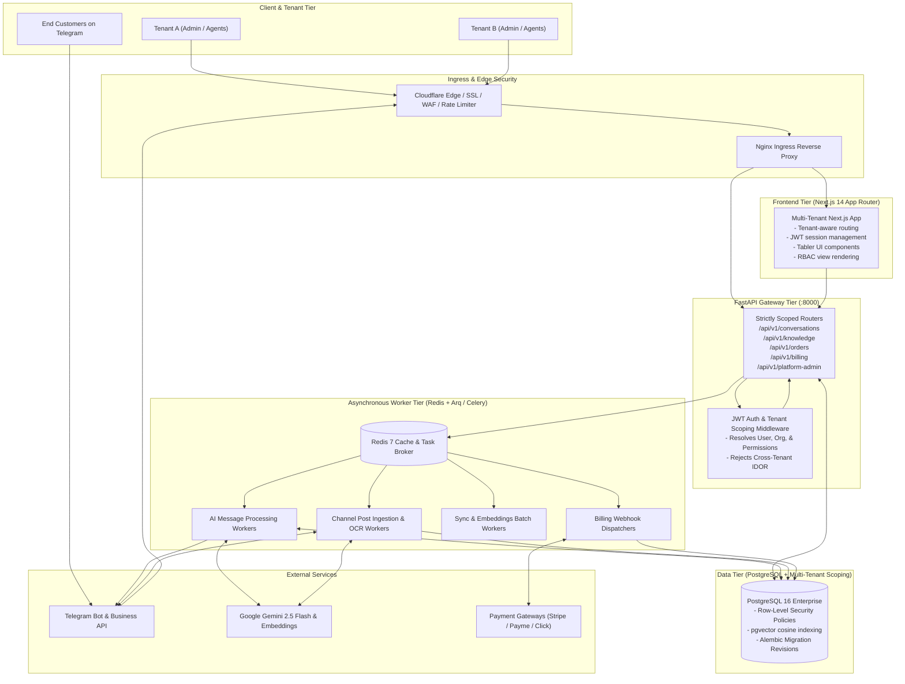
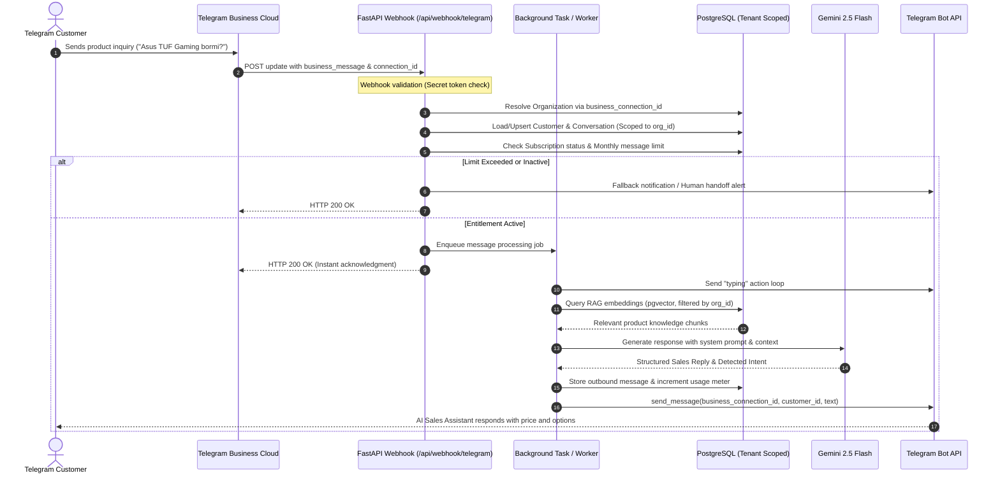
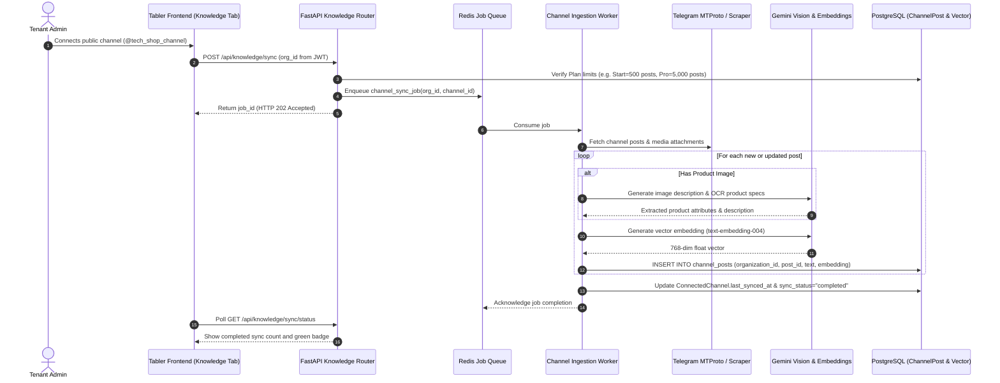
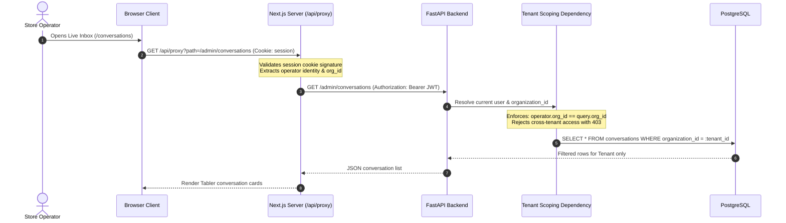

# AI SALES CONTROL CENTER — ARCHITECTURE MAP & DATA FLOW

**Document:** `docs/saas-audit/02_ARCHITECTURE_MAP.md`  
**Purpose:** Map the existing application topology against the target multi-tenant SaaS architecture and trace end-to-end data flows.

---

## 1. Current Architecture Topology (As-Is)

Currently, the system operates as a hybrid monolithic backend (FastAPI) paired with a Server-Side Rendered (SSR) / Static frontend (Next.js 14) and local PostgreSQL with `pgvector`.

---

## 2. Target Multi-Tenant SaaS Architecture Topology (To-Be)

In the target state, tenant isolation is strictly enforced at every layer (Network, Gateway, JWT Auth, Service Boundaries, and Database Query Scopes). Background workers handle asynchronous long-running tasks via Redis queues.

---

## 3. End-to-End Data Flow Tracing

### Flow 1: Inbound Customer Message & AI Sales Response

### Flow 2: Telegram Channel Knowledge Ingestion Pipeline

### Flow 3: Multi-Tenant Frontend Admin Request & Proxy Resolution

---

## 4. Architectural Gaps Identified in As-Is Flow

1. **Missing Asynchronous Broker:** The transition between Flow 1 step 7 and step 8 currently uses `asyncio.create_task()`. There is no retry mechanism, backoff policy, or persistence if FastAPI restarts.
2. **Channel Scraping Bottleneck:** In Flow 2, the HTTP GET scraper in `app/services/knowledge.py` cannot access historical archives or private seller channels, severely crippling RAG accuracy.
3. **Master Token Bypass in Proxy:** In Flow 3, `web/app/api/proxy/route.ts` currently replaces individual operator credentials with the master `X-Admin-Token`, destroying auditability and bypassing permission checks.

