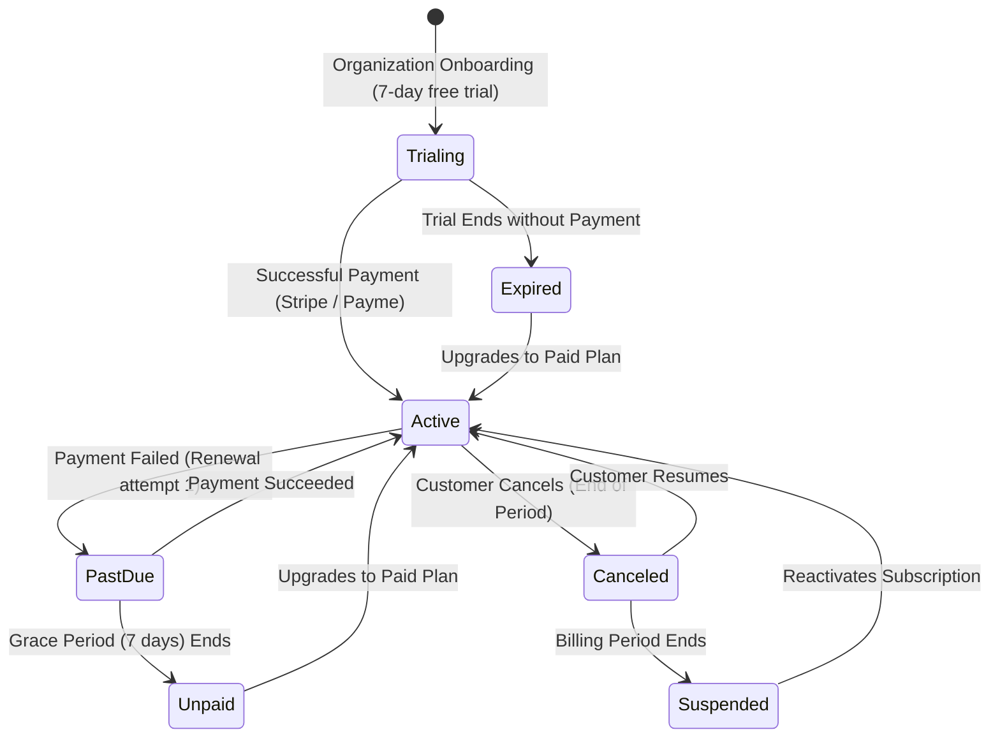

# AI SALES CONTROL CENTER — SaaS READINESS & MULTI-TENANCY AUDIT

**Document:** `docs/saas-audit/04_SAAS_READINESS.md`  
**Purpose:** Evaluate the system's readiness for commercial multi-tenant operation, identify isolation gaps, and define the necessary SaaS governance layer.

---

## 1. Multi-Tenancy Architecture Review

A true multi-tenant SaaS application requires **strict isolation across data storage, API execution, background workers, and caching**. In a shared database architecture (the pattern selected for this project), every single relational entity must be unambiguously tied to an `organization_id`, and all database queries must automatically include a tenant constraint.

### 1.1 Tenant Model Structure
The current models in `app/models.py` include:
* `Organization`: Stores company name, slug, logo, category, and trial status.
* `User`: Stores user identity, email, hashed password, and Telegram ID.
* `OrganizationMember`: Join table connecting `User` to `Organization` with a specific role (`owner`, `admin`, `operator`).
* `Subscription`: Stores `plan_id`, `status` (`trialing`, `active`, `past_due`, `canceled`), current billing period dates, and provider tokens.
* `UsageRecord`: Stores period-bound counters (`ai_messages_count`, `active_conversations_count`, `channel_posts_count`).

While these tables exist, **they are not consistently integrated with the rest of the application**.

---

## 2. Row-Level Isolation Gap Analysis (The IDOR Problem)

The most severe flaw discovered during the audit is that **the API routing and service layers largely ignore `organization_id`**.

| Endpoint / Operation | Current Vulnerability | Code Reference | Required Tenant Scoping Fix |
| :--- | :--- | :--- | :--- |
| `GET /admin/overview` | Aggregates all conversations, orders, and posts across all organizations. | `app/api/admin.py:85-95` | Add `.where(Conversation.organization_id == current_org_id)` |
| `GET /admin/conversations` | Lists conversations for every tenant in the database. | `app/api/admin.py:98-110` | Add `.where(Conversation.organization_id == current_org_id)` |
| `GET /admin/conversations/{id}/messages` | Direct Object Reference without tenant check (IDOR). Org B can read Org A's chat history. | `app/api/admin.py:113-116` | Verify `Conversation.organization_id == current_org_id` before returning messages. |
| `POST /admin/conversations/{id}/takeover` | Operator from Org B can seize control of Org A's customer conversations. | `app/api/admin.py:119-127` | Enforce tenant ownership check on `conversation_id`. |
| `POST /admin/conversations/{id}/reply` | Operator from Org B can send messages to Org A's Telegram customer. | `app/api/admin.py:141-150` | Enforce tenant ownership check on `conversation_id`. |
| `GET /admin/channels` | Lists all connected channels globally. | `app/api/admin.py:175-180` | Add `.where(ConnectedChannel.organization_id == current_org_id)` |
| `POST /admin/channels/sync` | Hardcoded sync dumps scraped data into `organization_id=1`. | `app/services/knowledge.py:301-314` | Dynamically resolve `organization_id` from the channel record. |
| `GET /admin/settings` | Returns global system settings, exposing system-wide secrets. | `app/api/admin.py:230-245` | Isolate settings per tenant or create a dedicated tenant settings table. |

### The Root Cause: Header-Based Tenant Resolution
In `app/api/saas.py` lines 73–87:
```python
async def resolve_organization_id(
    x_organization_id: str | None = Header(default=None),
    admin: Admin | None = Depends(get_current_admin_optional),
    db: AsyncSession = Depends(get_db),
) -> int:
    """Resolve active tenant organization_id from header or fallback to default org 1."""
    if x_organization_id:
        try:
            return int(x_organization_id)
        except ValueError:
            pass
    if admin and admin.organization_id:
        return admin.organization_id
    return 1
```
**Why this is dangerous:**
1. Any authenticated client can pass `X-Organization-Id: 2` and impersonate Organization 2.
2. If the client omits the header, the system defaults to `1`, mixing unassigned requests into the primary tenant's workspace.
3. There is **no verification that the calling user has active membership in that organization**.

---

## 3. Subscription & Feature Entitlements

The entitlement engine in `app/services/entitlement_service.py` provides two methods:
* `has_feature(db, org_id, feature_key) -> bool`
* `check_limit(db, org_id, metric_key, current_count) -> (bool, max_limit)`

### 3.1 Entitlement Enforcement Gaps
Currently, entitlements are defined in database JSON columns (`plans.features` and `plans.limits`), but are **not enforced at runtime**:
1. **Telegram Webhook Execution:** In `app/api/webhooks.py`, incoming customer messages are processed without checking if the organization has exceeded its `monthly_ai_messages` limit.
2. **Channel Post Sync:** In `app/services/knowledge.py`, channel scraping runs without verifying if the organization has reached its `knowledge_base_posts` quota (e.g. 500 for START plan).
3. **Team Members:** The `/admin/admins` endpoint allows adding unlimited team members regardless of whether the plan restricts it to 2 members (START) or 10 members (PRO).

---

## 4. Usage Tracking & Metering Architecture

### Current Implementation:
* Model: `UsageRecord` in `app/models.py`.
* Metrics tracked: `ai_messages_count`, `active_conversations_count`, `channel_posts_count`, `orders_count`.
* Service: `app/services/usage_service.py` contains `increment_usage()`, `get_current_usage()`, and `get_usage_dashboard()`.

### Missing Components:
1. **Real-time Atomic Increments:** Inbound and outbound messages in `app/api/webhooks.py` do not call `usage_service.increment_usage()`. Usage counters in the dashboard remain at 0 unless manually updated.
2. **Monthly Reset Automation:** There is no cron or scheduled job to close the current month's `UsageRecord` and initialize a fresh record for the new billing cycle.
3. **Usage Warning Triggers:** The system does not notify tenant owners when they reach 80%, 90%, or 100% of their plan limits.
4. **Soft vs. Hard Limits:** There is no policy defining whether the AI stops replying immediately upon hitting the limit, or degrades gracefully to human takeover with an overage notification.

---

## 5. Subscription Lifecycle & State Machine

The subscription lifecycle must handle the following states:



### Gap Analysis:
* **Current State:** The database model has `status`, `current_period_start`, and `current_period_end`.
* **Missing Logic:**
  * No background cron job checks for expired trials or overdue billing dates.
  * No webhook handler listens to Stripe `invoice.payment_failed` or `customer.subscription.deleted`.
  * If a subscription expires or fails, the AI sales assistant continues running indefinitely because the webhook handler does not verify subscription state before generating AI responses.

---

## 6. Tenant Onboarding & Team RBAC

### Onboarding Flow:
* The endpoint `POST /api/organizations` creates an organization and attaches a 7-day trial.
* However, because user authentication is stubbed (single shared password in `.env`), there is no true user sign-up flow. Every new organization must be manually associated with a Telegram user ID.

### Role-Based Access Control (RBAC):
* Roles defined in `app/core/permissions.py`:
  * `owner`: Full permissions, including billing, plan changes, team management, and organization deletion.
  * `admin`: Operational management, channel connections, AI prompt tuning, and team management.
  * `operator`: Live Inbox viewing, human customer takeover, and manual messaging.
* **Deficiency:** Permissions are hardcoded in a static dictionary and checked via `require_permission()`. However, because `web/app/api/proxy/route.ts` attaches the master `X-Admin-Token` to every request, the backend sees every caller as `role="owner"`, rendering the entire permission system completely useless in practice.

