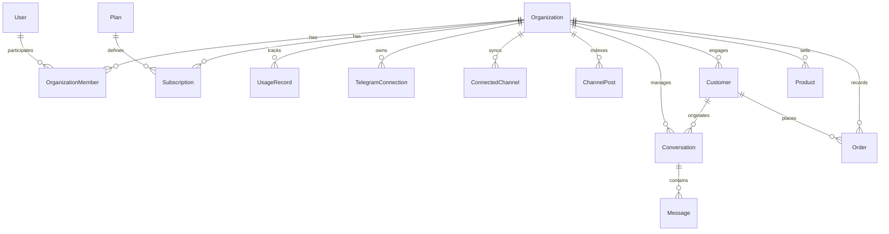

# AI SALES CONTROL CENTER — DATABASE ARCHITECTURE & MIGRATION AUDIT

**Document:** `docs/saas-audit/06_DATABASE_AUDIT.md`  
**Purpose:** Comprehensive audit of database models, relational integrity, vector storage, indexing, schema drift, and Alembic unification.

---

## 1. Relational Model Schema Inventory

The database is built on PostgreSQL 16 using SQLAlchemy 2.0 async and `pgvector`. The schema comprises 17 primary entities in `app/models.py`:



### Table Details & Foreign Key Constraints

| Table Name | Model Class | Primary Key | Tenant FK (`organization_id`) | Indexes Defined |
| :--- | :--- | :--- | :--- | :--- |
| `organizations` | `Organization` | `id` (Integer) | N/A (Root Tenant) | `slug` (Unique), `created_at` |
| `users` | `User` | `id` (Integer) | N/A (Global User) | `email` (Unique), `telegram_user_id` |
| `organization_members` | `OrganizationMember`| `id` (Integer) | `organization_id` (FK -> organizations.id) | `(org_id, user_id)` (Unique) |
| `plans` | `Plan` | `id` (Integer) | N/A (Global Catalog) | `code` (Unique), `is_active` |
| `subscriptions` | `Subscription` | `id` (Integer) | `organization_id` (FK -> organizations.id) | `organization_id` (Unique), `status` |
| `usage_records` | `UsageRecord` | `id` (Integer) | `organization_id` (FK -> organizations.id) | `(org_id, period_start, period_end)` |
| `telegram_connections`| `TelegramConnection`| `id` (Integer) | `organization_id` (FK -> organizations.id) | `connection_id` (Unique), `user_id` |
| `connected_channels` | `ConnectedChannel` | `id` (Integer) | `organization_id` (FK -> organizations.id) | `channel_id`, `username` |
| `channel_posts` | `ChannelPost` | `id` (Integer) | `organization_id` (FK -> organizations.id) | `post_id`, `embedding` (vector), `channel_id` |
| `customers` | `Customer` | `id` (Integer) | `organization_id` (FK -> organizations.id) | `telegram_user_id`, `(org_id, telegram_user_id)` |
| `conversations` | `Conversation` | `id` (Integer) | `organization_id` (FK -> organizations.id) | `telegram_chat_id`, `status`, `last_activity_at` |
| `messages` | `Message` | `id` (Integer) | `organization_id` (Nullable FK) | `conversation_id`, `created_at` |
| `products` | `Product` | `id` (Integer) | `organization_id` (FK -> organizations.id) | `sku`, `title`, `is_active` |
| `orders` | `Order` | `id` (Integer) | `organization_id` (FK -> organizations.id) | `order_number` (Unique), `customer_id`, `status` |
| `settings` | `Setting` | `id` (Integer) | Nullable / Missing | `key` (Unique) |
| `webhook_events` | `WebhookEvent` | `id` (Integer) | `organization_id` (Nullable FK) | `(provider, event_id)` (Unique) |
| `audit_logs` | `AuditLog` | `id` (Integer) | `organization_id` (Nullable FK) | `created_at`, `action` |

---

## 2. Critical Findings & Schema Flaws

### 2.1 Schema Drift and Alembic Disconnection
* **The Problem:** The repository has an active Alembic setup under `alembic/`, but it contains only **one single revision**:
  `alembic/versions/3d38b39cf960_init_schema.py` (created on Jan 30, 2026).
  This migration only created the initial 6 tables (`settings`, `connected_channels`, `channel_posts`, `conversations`, `messages`, `admins`).
* **Runtime DDL Hack:** To compensate, `app/main.py` lines 45–95 executes imperative raw SQL at application startup:
  ```python
  await db.execute(text("CREATE EXTENSION IF NOT EXISTS vector"))
  await db.execute(text("ALTER TABLE conversations ADD COLUMN IF NOT EXISTS organization_id INTEGER REFERENCES organizations(id)..."))
  await db.execute(text("ALTER TABLE channel_posts ADD COLUMN IF NOT EXISTS organization_id INTEGER REFERENCES organizations(id)..."))
  # ... 15+ ad-hoc ALTER TABLE commands!
  ```
* **Severe Impact:**
  1. Automated deployments will fail in CI/CD environments that rely on `alembic upgrade head`.
  2. Developers and staging databases cannot reliably reproduce schema states.
  3. Rollbacks (`alembic downgrade`) are impossible.
  4. Non-atomic DDL statements during application startup create potential race conditions if multiple FastAPI worker instances start concurrently.

### 2.2 Vector Embedding Indexing (`pgvector`)
* The column `channel_posts.embedding` uses `Vector(768)` (matching Gemini `text-embedding-004`).
* **Indexing Flaw:** There is currently **no HNSW or IVFFlat index** defined on this column in SQLAlchemy.
* **Performance Impact:** Every semantic similarity query (`order_by(ChannelPost.embedding.cosine_distance(query_vector))`) performs an unindexed **full sequential scan** (`Seq Scan`) across the entire `channel_posts` table. While acceptable with 100 rows, this will collapse database performance once tenants accumulate tens of thousands of channel posts.
* **Remediation:** Create an HNSW index filtered by `organization_id`:
  ```sql
  CREATE INDEX idx_channel_posts_embedding_hnsw 
  ON channel_posts USING hnsw (embedding vector_cosine_ops)
  WITH (m = 16, ef_construction = 64);
  ```

### 2.3 Composite Indexes for Tenant Isolation
Most queries in a multi-tenant system query by `organization_id` combined with another filter (e.g. `status`, `created_at`, or `telegram_chat_id`).
* Currently, `conversations` has separate single-column indexes on `organization_id` and `status`.
* **Required Index:**
  ```sql
  CREATE INDEX idx_conversations_org_status_activity 
  ON conversations (organization_id, status, last_activity_at DESC);
  ```
* Similarly for `customers`:
  ```sql
  CREATE UNIQUE INDEX idx_customers_org_telegram_id 
  ON customers (organization_id, telegram_user_id);
  ```
  *(Currently, a customer is unique only globally or unconstrained, preventing a single Telegram user from shopping across multiple independent client stores on the platform).*

---

## 3. Migration Unification Plan

To achieve enterprise database stability, we must execute a clean migration reconciliation:

1. **Phase 1: Dump Current Intended State:** Generate a complete Alembic migration representing the full multi-tenant schema as defined in `app/models.py`.
2. **Phase 2: Purge Imperative DDL from `app/main.py`:** Delete lines 45–95 in `app/main.py`. The application startup event must only check database connectivity (`SELECT 1`), never alter database structure.
3. **Phase 3: Baseline Existing Databases:** For existing production/staging instances, stamp the current schema revision using `alembic stamp <head_revision>`.
4. **Phase 4: CI/CD Enforcement:** Add an automated migration verification test to CI that executes `alembic upgrade head` on a clean PostgreSQL container and verifies that `alembic check` reports no pending drift.

