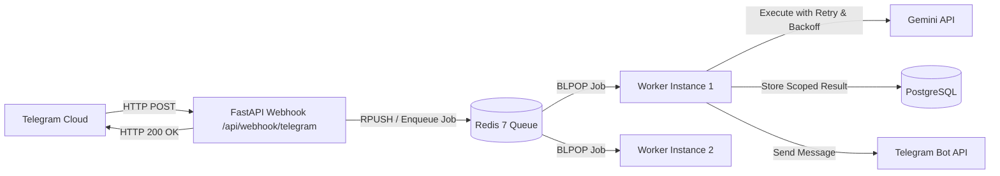

# AI SALES CONTROL CENTER — DEVOPS, INFRASTRUCTURE & RELIABILITY AUDIT

**Document:** `docs/saas-audit/09_DEVOPS_AUDIT.md`  
**Purpose:** Audit of containerization, infrastructure, background task processing, webhook reliability, monitoring, CI/CD, and deployment strategy.

---

## 1. Containerization & Docker Setup

### 1.1 Dockerfile (Backend)
* **Location:** `Dockerfile` (Root).
* **Base Image:** `python:3.11-slim`.
* **Strengths:** Multi-stage build patterns, non-root user execution, minimal image size.
* **Deficiencies:**
  * Uses `pip install -r requirements.txt` directly without frozen hashes.
  * Lacks health check instruction (`HEALTHCHECK CMD curl -f http://localhost:8000/health || exit 1`).
  * Exposes single port 8000; lacks configuration for graceful SIGTERM termination.

### 1.2 Dockerfile (Frontend)
* **Location:** `web/Dockerfile`.
* **Base Image:** `node:20-alpine`.
* **Strengths:** Standalone Next.js output build (`output: "standalone"`).
* **Deficiencies:** Build arguments for `BACKEND_URL` are baked into the container at build time rather than read at container runtime.

### 1.3 Docker Compose (`docker-compose.yml`)
* Current compose file orchestrates `postgres` (with `pgvector/pgvector:pg16`), `backend`, and `frontend`.
* **Missing Critical Infrastructure:**
  * **Redis:** Completely absent.
  * **Worker Service:** Completely absent. Background tasks execute inside the web server process.
  * **Persistent Volume Retention:** Volume `postgres_data` is configured, but there are no automated database backup hooks or WAL archiving.

---

## 2. Background Task Execution & The "Ephemeral Task" Crisis

### 2.1 The Current Mechanism
In `app/api/webhooks.py`:
```python
# Line 365:
asyncio.create_task(handle_business_message_async(db, update.business_message))
# Line 410:
asyncio.create_task(handle_channel_post_async(db, update.channel_post))
# Line 428:
asyncio.create_task(handle_connection_async(db, update.business_connection))
```

### 2.2 Why `asyncio.create_task` is Inadequate for Production SaaS:
1. **Silent Dropped Tasks on Restarts:** When the FastAPI container restarts, redeploys, or crashes under OOM (Out-of-Memory), all in-flight `create_task()` promises are instantly destroyed.
2. **Telegram Acknowledgment Trap:** Because `create_task()` runs asynchronously in the background, `app/api/webhooks.py` returns `{"ok": True}` (HTTP 200) to Telegram within 20 milliseconds. Because Telegram received an HTTP 200, **Telegram will NEVER retry the webhook**. The customer's message is lost forever!
3. **No Concurrency Controls:** If 500 customers message a merchant simultaneously, FastAPI spawns 500 concurrent coroutines attempting to call Gemini and the database at the exact same moment. This exhausts the database connection pool (`asyncpg.exceptions.TooManyConnectionsError`) and triggers rate limits from the Gemini API.
4. **No Backoff or Retry on Network Blips:** If Gemini API or Telegram Bot API experiences a transient 2-second timeout, the coroutine fails, logs an error, and dies. There is no exponential backoff or dead-letter queue (DLQ).

### 2.3 Required Architecture: Redis + Task Broker (Arq / Celery)


---

## 3. Webhook Ingress & Tunnel Reliability

### 3.1 Local Development Tunnels
The development environment relies on reverse tunnels:
* `localhost.run` (`https://c95ef3cbaddcbf.lhr.life`)
* Cloudflare Tunnel (`cloudflared`)

### 3.2 Production Webhook Requirements:
1. **Static Ingress FQDN:** A fixed domain name (`https://api.aisales.uz/api/webhook/telegram`) fronted by Cloudflare with strict SSL.
2. **Webhook Idempotency:** Telegram guarantees "at-least-once" delivery. Duplicate webhooks for the same `update_id` must be rejected using an atomic Redis key (`SET update_id:{id} 1 EX 86400 NX`).
3. **Telegram IP Allowlisting:** Restrict inbound traffic to official Telegram IP CIDR ranges (`149.154.160.0/20` and `91.108.4.0/22`) at the Cloudflare / Nginx firewall level to neutralize volumetric DDoS attacks.

---

## 4. Logging, Metrics & Observability

### Current Implementation:
* Logging via Python's standard `logging` in `app/core/logging.py`.
* Logs are emitted to console stdout in plain text.

### Missing Enterprise Observability:
1. **Structured JSON Logs:** In production, logs must be structured JSON (including `timestamp`, `level`, `trace_id`, `organization_id`, `telegram_chat_id`) for aggregation into Datadog, Grafana Loki, or ELK.
2. **Prometheus Metrics:** No `/metrics` endpoint exists to monitor request latency, active WebSocket connections, Gemini API token consumption, or queue depth.
3. **Application Performance Monitoring (APM):** Sentry or OpenTelemetry tracing is not configured. When a customer receives no reply, operators cannot trace which sub-system failed.

---

## 5. Backup, Disaster Recovery & High Availability

* **PostgreSQL Backups:** Currently nonexistent. There is no automated cron executing `pg_dump` or streaming WAL logs to S3/Cloud Storage.
* **Recovery Time Objective (RTO):** Estimated at 4–8 hours (manual reconstruction).
* **Recovery Point Objective (RPO):** Up to 24 hours of lost customer conversations in the event of hardware disk failure.
* **Target RTO / RPO for SaaS:**
  * RTO < 30 minutes.
  * RPO < 5 minutes (enforced via continuous WAL archiving to Wasabi / AWS S3).

