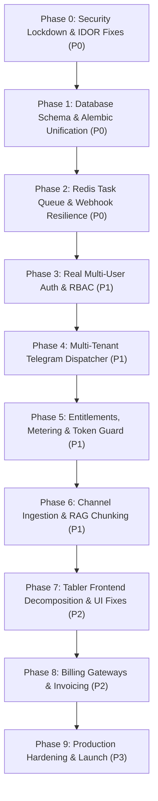

# AI SALES CONTROL CENTER — SAAS TRANSFORMATION ROADMAP & WBS

**Document:** `docs/saas-audit/11_IMPLEMENTATION_ROADMAP.md`  
**Purpose:** Actionable, phase-by-phase engineering implementation roadmap and Work Breakdown Structure (WBS).

---

## 1. Roadmap Architecture & Execution Sequence

---

## 2. Phase 0: Security Lockdown & Tenant Isolation (Priority: P0 — Immediate)

### T-0.1: Fix Telegram Webhook Secret Bypass
* **Objective:** Ensure all inbound webhook calls strictly validate the `X-Telegram-Bot-Api-Secret-Token` header.
* **Target Files:** `app/api/webhooks.py`
* **Complexity:** XS (1 hour) | **Priority:** P0 | **Dependencies:** None
* **Definition of Done:** Requests missing the secret header return HTTP 401 Unauthorized; unit tests verify rejection of forged webhooks.

### T-0.2: Eliminate Header-Based User Impersonation
* **Objective:** Remove `X-Admin-Telegram-ID` header authentication fallback in `get_current_admin()`.
* **Target Files:** `app/api/admin.py`
* **Complexity:** S (2 hours) | **Priority:** P0 | **Dependencies:** None
* **Definition of Done:** Direct API requests to port 8000 require authentic cryptographic Bearer JWT tokens.

### T-0.3: Enforce Row-Level Tenant Isolation on Admin Endpoints
* **Objective:** Add mandatory `WHERE organization_id = :org_id` clauses to all admin and overview queries.
* **Target Files:** `app/api/admin.py`, `app/api/saas.py`
* **Complexity:** M (1 day) | **Priority:** P0 | **Dependencies:** T-0.2
* **Definition of Done:** An operator from Org A querying `/admin/conversations` or `/admin/conversations/{id}/messages` receives an empty list or HTTP 404/403 for Org B's entities.

### T-0.4: Sanitize Next.js Backend Proxy
* **Objective:** Stop injecting master `X-Admin-Token` in the Next.js proxy; forward caller's authenticated JWT session.
* **Target Files:** `web/app/api/proxy/route.ts`, `web/lib/session.ts`
* **Complexity:** M (1 day) | **Priority:** P0 | **Dependencies:** T-0.2
* **Definition of Done:** Browser requests authenticate as the specific logged-in user without privilege escalation.

---

## 3. Phase 1: Database Migration & Alembic Unification (Priority: P0)

### T-1.1: Consolidate Alembic Migration History
* **Objective:** Generate a single, comprehensive Alembic revision containing all tables, foreign keys, and indexes.
* **Target Files:** `alembic/versions/`, `alembic/env.py`
* **Complexity:** M (1 day) | **Priority:** P0 | **Dependencies:** None
* **Definition of Done:** `alembic upgrade head` creates the complete multi-tenant database on a clean PostgreSQL instance without errors.

### T-1.2: Purge Startup DDL Hacks from `app/main.py`
* **Objective:** Delete lines 45–95 in `app/main.py` that execute imperative `ALTER TABLE` statements.
* **Target Files:** `app/main.py`
* **Complexity:** S (2 hours) | **Priority:** P0 | **Dependencies:** T-1.1
* **Definition of Done:** Server startup only tests connection readiness; zero runtime DDL executed.

### T-1.3: Add HNSW Index for `pgvector`
* **Objective:** Create cosine HNSW index on `channel_posts.embedding` with tenant partitioning.
* **Target Files:** `app/models.py`, Alembic migration
* **Complexity:** S (3 hours) | **Priority:** P0 | **Dependencies:** T-1.1
* **Definition of Done:** `EXPLAIN ANALYZE` confirms index scan instead of sequential scan on vector queries.

---

## 4. Phase 2: Asynchronous Task Broker & Ingestion Pipeline (Priority: P0)

### T-2.1: Integrate Redis & Task Broker (Arq / Celery)
* **Objective:** Introduce Redis 7 container and configure an async background worker pool.
* **Target Files:** `docker-compose.yml`, `app/core/queue.py`, `app/workers/`
* **Complexity:** L (2 days) | **Priority:** P0 | **Dependencies:** None
* **Definition of Done:** Background jobs enqueue to Redis; worker executes jobs with exponential backoff retries.

### T-2.2: Refactor Telegram Webhook Dispatching
* **Objective:** Replace `asyncio.create_task()` in `app/api/webhooks.py` with Redis task enqueuing.
* **Target Files:** `app/api/webhooks.py`, `app/workers/telegram_worker.py`
* **Complexity:** M (1.5 days) | **Priority:** P0 | **Dependencies:** T-2.1
* **Definition of Done:** Inbound webhook responds with HTTP 200 within 30ms; message processing survives container restarts.

---

## 5. Phase 3: Multi-User Identity, JWT Auth & Organization Switcher (Priority: P1)

### T-3.1: True User Registration & Password Hashing
* **Objective:** Implement bcrypt password hashing, registration, and email verification in backend.
* **Target Files:** `app/services/auth_service.py`, `app/api/auth.py`, `app/models.py`
* **Complexity:** L (2 days) | **Priority:** P1 | **Dependencies:** T-0.3
* **Definition of Done:** Users can sign up, log in, and receive signed JWT access and refresh tokens.

### T-3.2: Telegram Login Widget Integration
* **Objective:** Allow business owners to sign in using their Telegram account via the official Telegram Login Widget.
* **Target Files:** `app/api/auth.py`, `web/app/login/page.tsx`
* **Complexity:** M (1 day) | **Priority:** P1 | **Dependencies:** T-3.1
* **Definition of Done:** Users authenticate securely with one click via Telegram; account auto-linked to `User.telegram_user_id`.

### T-3.3: Frontend Organization Switcher & Context
* **Objective:** Add organization dropdown in Tabler top navbar and create React `TenantContext`.
* **Target Files:** `web/app/components/Navbar.tsx`, `web/lib/context/AuthContext.tsx`
* **Complexity:** M (1 day) | **Priority:** P1 | **Dependencies:** T-3.1
* **Definition of Done:** Users can switch between multiple organizations without re-authenticating; UI updates instantly.

---

## 6. Phase 4: Multi-Tenant Telegram Connection & Dispatcher (Priority: P1)

### T-4.1: Dynamic Bot & Connection Routing
* **Objective:** Route incoming Telegram updates to the correct tenant based on `business_connection_id` or bot token.
* **Target Files:** `app/api/webhooks.py`, `app/services/telegram.py`
* **Complexity:** M (1.5 days) | **Priority:** P1 | **Dependencies:** T-2.2
* **Definition of Done:** Multiple organizations can connect their own Telegram Business accounts simultaneously without conflicts.

### T-4.2: Revocation & Status Lifecycle
* **Objective:** Properly handle Telegram connection disablement/revocation events.
* **Target Files:** `app/api/webhooks.py`, `app/models.py`
* **Complexity:** S (4 hours) | **Priority:** P1 | **Dependencies:** T-4.1
* **Definition of Done:** When a user disconnects the bot in Telegram Business settings, tenant connection is flagged `inactive`.

---

## 7. Phase 5: Entitlements, Metering & Token Guard (Priority: P1)

### T-5.1: Pre-Invocation Message Quota Gate
* **Objective:** Enforce `monthly_ai_messages` quota check before invoking Gemini in the webhook pipeline.
* **Target Files:** `app/workers/telegram_worker.py`, `app/services/entitlement_service.py`
* **Complexity:** M (1 day) | **Priority:** P1 | **Dependencies:** T-2.2
* **Definition of Done:** If tenant exceeds quota, AI pauses, notifies human operator, and prompts tenant to upgrade.

### T-5.2: Atomic Real-Time Usage Tracking
* **Objective:** Increment `ai_messages_count` and `active_conversations_count` atomically on every processed turn.
* **Target Files:** `app/services/usage_service.py`, `app/workers/telegram_worker.py`
* **Complexity:** S (4 hours) | **Priority:** P1 | **Dependencies:** T-2.2
* **Definition of Done:** Usage dashboard meters reflect real-time message consumption accurately.

### T-5.3: Chat Loop Guard (Cost Firewall)
* **Objective:** Detect and terminate rapid bot-to-bot messaging loops (>15 msgs / 5 mins).
* **Target Files:** `app/services/ai.py`, `app/workers/telegram_worker.py`
* **Complexity:** S (4 hours) | **Priority:** P1 | **Dependencies:** None
* **Definition of Done:** Automatic handoff triggered when loop threshold is breached.

---

## 8. Phase 6: Channel Ingestion Modernization & RAG Chunking (Priority: P1)

### T-6.1: Fix Channel Ingestion Hardcoded Org ID
* **Objective:** Dynamically resolve `organization_id` in `app/services/knowledge.py` line 304.
* **Target Files:** `app/services/knowledge.py`
* **Complexity:** XS (1 hour) | **Priority:** P1 | **Dependencies:** None
* **Definition of Done:** Channel posts are saved strictly under the channel's owning organization.

### T-6.2: Implement MTProto Historical Channel Sync
* **Objective:** Use Pyrogram/Telethon userbot session to fetch complete historical channel posts with pagination.
* **Target Files:** `app/services/telegram_mtproto.py`, `app/services/knowledge.py`
* **Complexity:** XL (3 days) | **Priority:** P1 | **Dependencies:** T-2.1
* **Definition of Done:** Successfully imports 500+ historical catalog posts from public and private channels.

### T-6.3: Semantic Document Chunking & Hybrid Search
* **Objective:** Split channel posts into 200-word chunks and add PostgreSQL full-text search (tsvector) combined with vector cosine distance.
* **Target Files:** `app/services/knowledge.py`, Alembic migration
* **Complexity:** L (2 days) | **Priority:** P1 | **Dependencies:** T-1.3
* **Definition of Done:** SKU and model number searches return exact product matches with higher recall.

---

## 9. Phase 7: Tabler Frontend Decomposition & UI Fixes (Priority: P2)

### T-7.1: Fix Admin Permission Badge Stacking Bug
* **Objective:** Replace vertical flex layout in admin table with horizontal wrapping badges.
* **Target Files:** `web/app/Dashboard.tsx`
* **Complexity:** S (2 hours) | **Priority:** P2 | **Dependencies:** None
* **Definition of Done:** Badges wrap cleanly in a compact container without expanding table rows vertically.

### T-7.2: Decompose Monolithic `Dashboard.tsx`
* **Objective:** Split 1,800-line file into dedicated Next.js App Router pages under `/dashboard/`.
* **Target Files:** `web/app/dashboard/*`, `web/app/Dashboard.tsx`
* **Complexity:** L (2 days) | **Priority:** P2 | **Dependencies:** T-3.3
* **Definition of Done:** Codebase is modular; pages load independently with reduced bundle sizes.

---

## 10. Phase 8: Billing Gateways & Invoicing (Priority: P2)

### T-8.1: Stripe Webhook Signature Verification
* **Objective:** Implement cryptographic verification for Stripe webhooks.
* **Target Files:** `app/services/billing_service.py`, `app/api/saas.py`
* **Complexity:** S (4 hours) | **Priority:** P2 | **Dependencies:** None
* **Definition of Done:** Fake synthetic webhook events are rejected; valid Stripe events upgrade subscriptions.

### T-8.2: Integrate Local Payment Gateways (Payme & Click)
* **Objective:** Add Uzbek national payment gateways (Payme / Click) for domestic card processing.
* **Target Files:** `app/services/billing_service.py`, `app/api/saas.py`
* **Complexity:** L (2.5 days) | **Priority:** P2 | **Dependencies:** T-8.1
* **Definition of Done:** Merchants in Uzbekistan can subscribe to START/PRO using Uzcard/Humo cards.

---

## 11. Phase 9: Production Hardening & Launch (Priority: P3)

### T-9.1: Structured Logging & Prometheus Metrics
* **Objective:** Emit JSON logs and expose `/metrics` for Grafana monitoring.
* **Target Files:** `app/core/logging.py`, `app/main.py`
* **Complexity:** M (1 day) | **Priority:** P3 | **Dependencies:** None
* **Definition of Done:** Real-time dashboards track request rate, error rate, and Gemini token burn rate.

### T-9.2: Automated Database Backup & Disaster Recovery
* **Objective:** Automated nightly encrypted `pg_dump` pushed to S3/Wasabi with 30-day retention.
* **Target Files:** `scripts/backup.sh`, `docker-compose.yml`
* **Complexity:** S (4 hours) | **Priority:** P3 | **Dependencies:** None
* **Definition of Done:** Backups run on schedule; restore script successfully recovers database.

