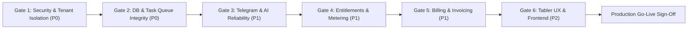

# AI SALES CONTROL CENTER — ACCEPTANCE CRITERIA & VERIFICATION CHECKLIST

**Document:** `docs/saas-audit/12_ACCEPTANCE_CRITERIA.md`  
**Purpose:** Formal verification gates and acceptance criteria required before approving commercial SaaS onboarding.

---

## 1. Acceptance Gates Overview

To prevent premature commercial launch, the platform must satisfy **100% of P0 gates** and **at least 90% of P1 gates**.

---

## 2. Gate 1: Security & Multi-Tenant Isolation (P0 — Mandatory)

| Test ID | Scenario | Test Procedure | Expected Result | Status |
| :--- | :--- | :--- | :--- | :---: |
| **AC-SEC-01** | Telegram Webhook Secret Validation | Send `POST /api/webhook/telegram` without header `X-Telegram-Bot-Api-Secret-Token`. | Returns `HTTP 401 Unauthorized` with JSON error payload. Request is aborted. | **Pending Fix** |
| **AC-SEC-02** | Master Admin Header Impersonation | Send request to `/admin/overview` with only `X-Admin-Telegram-ID: 6990611858`. | Returns `HTTP 401 Unauthorized`. Requires valid JWT token. | **Pending Fix** |
| **AC-SEC-03** | Cross-Tenant Conversation Isolation | Tenant B operator requests `GET /admin/conversations/{id}/messages` where `id` belongs to Tenant A. | Returns `HTTP 404 Not Found` or `HTTP 403 Forbidden`. No messages leaked. | **Pending Fix** |
| **AC-SEC-04** | Cross-Tenant Takeover Prevention | Tenant B operator requests `POST /admin/conversations/{id}/takeover` for Tenant A's chat. | Returns `HTTP 404/403`. Status of Tenant A conversation remains unchanged. | **Pending Fix** |
| **AC-SEC-05** | Next.js Proxy Tenant Hijacking | Authenticated user passes `X-Organization-Id: 2` to Next.js proxy when user only belongs to Org 1. | Backend validates JWT claims against requested org and returns `HTTP 403 Forbidden`. | **Pending Fix** |

---

## 3. Gate 2: Database Integrity & Task Queue (P0 — Mandatory)

| Test ID | Scenario | Test Procedure | Expected Result | Status |
| :--- | :--- | :--- | :--- | :---: |
| **AC-DAT-01** | Clean Alembic Migration | Run `alembic upgrade head` on a newly created empty PostgreSQL database. | All tables, foreign keys, enums, and indexes create without errors or warnings. | **Pending Fix** |
| **AC-DAT-02** | Zero Startup DDL Hacks | Inspect startup logs of FastAPI service. | No `ALTER TABLE` or `CREATE TABLE` raw SQL statements executed during startup. | **Pending Fix** |
| **AC-DAT-03** | Webhook Task Persistence | Restart FastAPI container while 50 incoming messages are being processed. | Messages in Redis task queue survive restart and are processed upon worker boot. Zero lost messages. | **Pending Fix** |
| **AC-DAT-04** | Vector Query Index Verification | Run `EXPLAIN ANALYZE` on vector cosine distance query with 10,000 mock posts. | Execution plan demonstrates an Index Scan (`idx_channel_posts_embedding_hnsw`), not Seq Scan. | **Pending Fix** |

---

## 4. Gate 3: Telegram Business & AI Sales Engine (P1)

| Test ID | Scenario | Test Procedure | Expected Result | Status |
| :--- | :--- | :--- | :--- | :---: |
| **AC-TEL-01** | Multi-Tenant Business Connections | Connect two separate Telegram Business accounts to Org 1 and Org 2. | Messages to Account 1 invoke Org 1 AI; messages to Account 2 invoke Org 2 AI without interference. | **Pending Fix** |
| **AC-TEL-02** | Typing Indicator Feedback | Send customer message on Telegram. | Telegram UI shows "...is typing" indicator within 1s, continuing until message arrives. | **Passed** |
| **AC-TEL-03** | RAG Accurate Product Matching | Ask "HP Victus narxi qancha?" when catalog contains HP Victus with price $850. | AI replies in polite Uzbek with exact $850 price and specs from catalog. | **Passed** |
| **AC-TEL-04** | Out-of-Stock Guardrail | Ask about an item explicitly absent from the catalog. | AI politely states the item is currently unavailable and offers related alternatives. | **Passed** |
| **AC-TEL-05** | Human Handoff Push Alert | Customer says "Operatorga ula, gaplashishim kerak". | AI pauses, sets `human_takeover`, and immediately sends Telegram bot alert to merchant. | **Pending Fix** |

---

## 5. Gate 4: Feature Entitlements & Metering (P1)

| Test ID | Scenario | Test Procedure | Expected Result | Status |
| :--- | :--- | :--- | :--- | :---: |
| **AC-ENT-01** | Monthly Message Hard Quota | Tenant on START plan sends 1,001st message in current billing cycle. | AI stops auto-replying; sends graceful notification; prompts merchant to upgrade in dashboard. | **Pending Fix** |
| **AC-ENT-02** | Real-Time Meter Increment | Send 5 messages in Telegram. | Usage dashboard `/api/usage` immediately reflects +5 count in `ai_messages_count`. | **Pending Fix** |
| **AC-ENT-03** | Knowledge Post Limit Gate | Tenant on START plan (limit 500 posts) attempts to sync channel with 800 posts. | Sync stops at 500 posts; warning displayed explaining plan limit reached. | **Pending Fix** |
| **AC-ENT-04** | Rapid Message Loop Guard | Simulate two automated bots exchanging 20 messages in 2 minutes. | Loop detector triggers at turn 15; conversation transferred to `human_takeover`. | **Pending Fix** |

---

## 6. Gate 5: Billing & Subscription Lifecycle (P1)

| Test ID | Scenario | Test Procedure | Expected Result | Status |
| :--- | :--- | :--- | :--- | :---: |
| **AC-BIL-01** | Trial Expiration Suspension | Set `trial_ends_at` to past timestamp on organization with no active card. | Subscription status transitions to `expired`; AI auto-reply disabled until payment. | **Pending Fix** |
| **AC-BIL-02** | Valid Stripe Webhook Upgrade | Send signed Stripe `checkout.session.completed` event for PRO plan. | Organization subscription immediately updates to `status="active"`, `plan="pro"`. | **Pending Fix** |
| **AC-BIL-03** | Forged Webhook Rejection | Send unsigned or improperly signed webhook to `/api/billing/webhook`. | Returns `HTTP 400 Bad Request`. No subscription state modified. | **Pending Fix** |
| **AC-BIL-04** | Plan Upgrade Proration | Upgrade from START ($19) to PRO ($59) mid-cycle. | Billing provider applies credit; limits for PRO plan unlock instantly in dashboard. | **Pending Fix** |

---

## 7. Gate 6: Tabler Frontend & UX (P2)

| Test ID | Scenario | Test Procedure | Expected Result | Status |
| :--- | :--- | :--- | :--- | :---: |
| **AC-UI-01** | Team Permissions Layout | Inspect Admin management table in Team & Access tab. | Permissions wrap cleanly in compact badges without distorting table row heights. | **Pending Fix** |
| **AC-UI-02** | Multi-Tenant Organization Switcher | User belonging to two organizations clicks switcher in top navbar. | Active workspace switches instantly; data tables reload scoped to newly selected organization. | **Pending Fix** |
| **AC-UI-03** | Error Toast Handling | Trigger validation error or missing resource. | Displays friendly Tabler alert toast; no raw `HTTP 500` or `HTTP 405` red popups. | **Pending Fix** |
| **AC-UI-04** | Tabler Visual Compliance | Review all screens against Tabler UI specifications. | Native Tabler colors, buttons, cards, typography, and clean dark mode preserved. | **Passed** |

